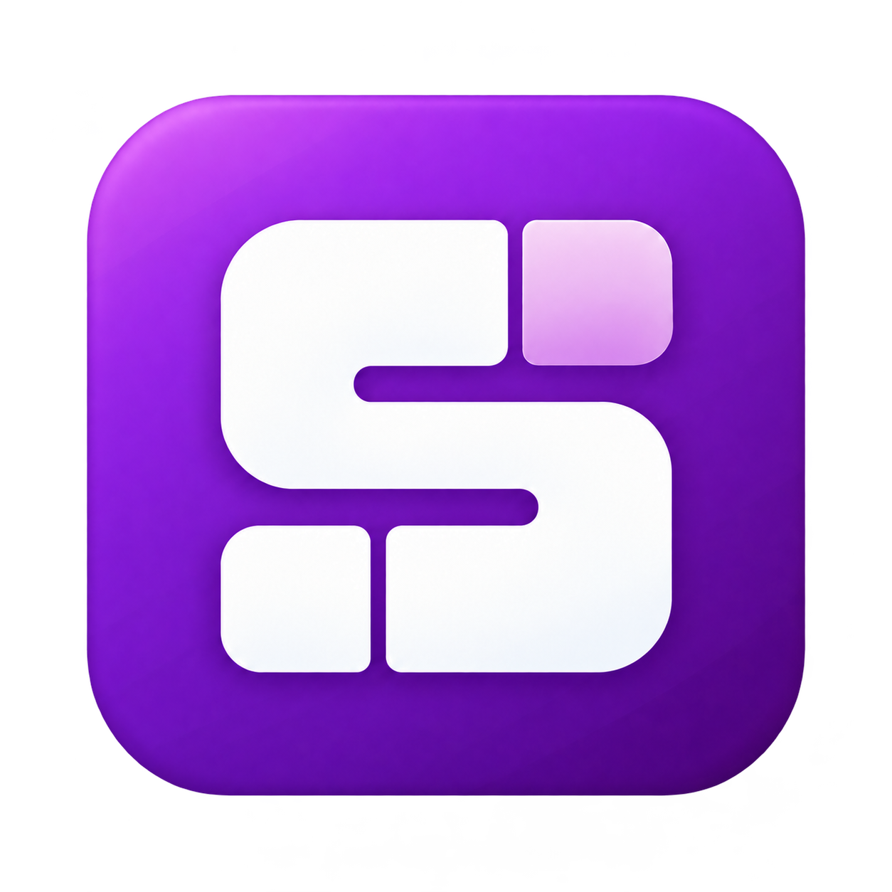

<p align="center">
  
</p>

<h1 align="center">Something</h1>

<p align="center">
  <b>ディスクの空き容量を、どこが使っているのか。どこが増えているのか。</b>
</p>

Something は、Windows のドライブを調べて、どのフォルダーやファイルがどれだけ容量を使っているかを一覧で表示するアプリです。過去の結果と比べて、容量が増え続けている場所も見つけられます。

## できること

| 機能 | 内容 |
| --- | --- |
| **容量を調べる** | フォルダーを順にたどりながら、容量の大きいフォルダーやファイルを探せます。 |
| **増減を比べる** | 前回のスキャンや「7 日間」「今月」などの期間と比べて、どこがどれだけ増えたかを確認できます。 |
| **複数のドライブを調べる** | ドライブごとにスキャンでき、途中でキャンセルすることもできます。 |
| **履歴を残す** | スキャン結果はパソコン内に保存され、あとから日時を選んで見直したり、削除したりできます。 |
| **整理する** | 見つけたファイルやフォルダーを、エクスプローラーで開いたり、確認のうえでごみ箱に移動したりできます。 |
| **書き出す** | 一覧やフォルダーごとの集計を、CSV・Excel 向けの表、HTML、JSON などのファイルに保存して、ほかのツールで使えます。 |

## 動作環境

- Windows 10 / Windows 11（64 ビット版）
- パソコン内のドライブ（NTFS 形式。Windows の通常のドライブはこの形式です）
- 管理者として実行できること

> [!NOTE]
> ドライブの情報を直接読み取るため、起動するたびに「このアプリがデバイスに変更を加えることを許可しますか？」と表示されます。「はい」を選んでください。スキャンはドライブを読み取るだけで、ファイルを書き換えることはありません。

## インストール

1. [リリースページ](https://github.com/mug-lab-3/something/releases/latest)を開き、`Something-v（バージョン）-win-x64.msi` をダウンロードします。
2. ダウンロードしたファイルをダブルクリックし、画面の案内に従ってインストールします。
3. スタートメニューの「Something」から起動します。

> [!WARNING]
> 「Windows によって PC が保護されました」と表示された場合は、「詳細情報」を押してから「実行」を押してください。このアプリはまだ発行元の電子署名を取得していないため、この警告が表示されます。

<details>
<summary>ダウンロードしたファイルが本物か確かめるには</summary>

リリースページにある `SHA256SUMS.txt` に、正しいファイルの識別番号（ハッシュ値）が書かれています。PowerShell で次のコマンドを実行し、表示された値が同じであれば、ダウンロードしたファイルは本物です。

```powershell
Get-FileHash .\Something-v1.1.5-win-x64.msi -Algorithm SHA256
```

GitHub CLI を使える場合は、`gh attestation verify .\Something-v1.1.5-win-x64.msi --repo mug-lab-3/something` でも確認できます。詳しくは[配布の説明](docs/deployment.md#github-release)を参照してください。

</details>

### アンインストール

Windows の「設定」→「アプリ」→「インストールされているアプリ」から「Something」をアンインストールします。スキャンの履歴と設定は削除されずに残ります。不要な場合は、エクスプローラーのアドレス欄に `%LOCALAPPDATA%\Something` と入力して開いたフォルダーを削除してください。

## 使い方

1. 画面上部に並ぶドライブのうち、調べたいドライブの右上にある **スキャン** ボタン（円形の矢印）を押します。
2. スキャンが終わったら、**ファイル** タブで左のフォルダーをたどり、どこが容量を使っているかを確認します。
3. **容量分析** タブでは、選んだフォルダーの中身を容量の大きい順に一覧できます。
4. 2 回以上スキャンしたあとは、上部の **比較** で期間を選ぶと、容量の増減が表示されます。
5. 不要なファイルは、一覧の右端にある **ごみ箱** ボタンでごみ箱に移動できます。移動する前に、必ず確認画面が表示されます。

右上の矢印ボタン（エクスポート）を押すと、表示中の一覧やフォルダーごとの集計をファイルに保存できます。形式は、プレーンテキスト・HTML・CSV・TSV・JSON・Parquet から選べます。

右上の歯車ボタンを押すと、設定画面が開きます。ダークモード・ライトモード・システム設定に従うテーマの選択、隠しファイルやシステムファイルを一覧と合計に含めるかどうか、履歴の保存先などを変更できます。テーマは保存され、次回起動時にも反映されます。

## 知っておいてほしいこと

- **表示するサイズ**は、ファイルがディスク上で実際に使っている容量です。同じファイルが複数の場所に登録されている場合（ハードリンク）は、それぞれの場所で数えます。そのため、一覧の合計がドライブの使用量と一致しないことがあります。
- **スキャン**は、ボタンを押したときだけ行います。常に監視したり、自動で定期的にスキャンしたりはしません。
- **履歴**は、直近 7 日間のスキャンはすべて、それより前のスキャンは 1 日につき最後の 1 回分だけを残します。
- **ファイルを変更する操作**は、確認画面で承認したごみ箱への移動だけです。完全に削除することはありません。
- **インターネットへの接続**は、起動時の新しいバージョンの確認だけです。GitHub に最新版の番号を問い合わせ、新しい版があればお知らせします。スキャン結果やファイルの情報は送信しません。更新は自動では行わないので、お知らせの「リリースページを開く」からダウンロードしてインストールしてください。確認は設定画面の「アプリ」→「更新」でオフにできます。
- スキャンの最中にもファイルは変化するため、読み取れなかった容量や比較できない項目は「不明」と表示します。

## ソースからビルドする

開発に参加する方や、ソースから動かしたい方向けの手順です。Git と VS Code（`code` コマンドを使える状態）を用意し、このリポジトリをクローンしてから、ルートで次のコマンドを実行します。Visual Studio は不要です。

```powershell
powershell.exe -NoProfile -ExecutionPolicy Bypass -File scripts/setup.ps1 -Open
dotnet build src/Something.App -c Release
```

セットアップでは、版を固定した SDK と依存関係を準備し、ビルドとテストを実行します。初回はネットワーク接続が必要です。ビルドが終わったら、次の exe を起動します。

```text
src/Something.App/bin/Release/net10.0-windows10.0.26100.0/win-x64/Something.App.exe
```

> [!TIP]
> `run-demo.bat` を使うと、実際のディスクは読まずに、合成データの 3 ドライブで操作を試せるデモを起動できます。

詳しい手順は[開発環境](docs/development.md)、インストーラーの作り方は[配布](docs/deployment.md)、アプリの仕組みは[技術ドキュメント](docs/README.md)を参照してください。

使用技術: C# 14 / .NET 10 / WinUI 3 / DuckDB / EF Core

## ライセンス

[MIT License](LICENSE) です。配布物に含まれるライブラリのライセンス表示は [THIRD-PARTY-NOTICES.md](THIRD-PARTY-NOTICES.md) にあります。
