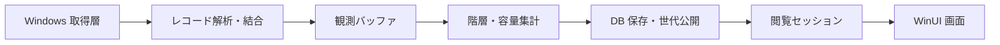

# アーキテクチャ

## プロジェクトの境界

| プロジェクト | 責務 |
| --- | --- |
| `Something.Ntfs` | バイト列の解析、属性とデータランの解読、レコード結合、取得インターフェースと再検証 |
| `Something.Windows` | ボリュームと Windows API への読み取り専用アクセス、ファイル識別、Shell 操作 |
| `Something.Statistics` | 階層検証、容量帰属、フォルダ集計、表示対象の判定 |
| `Something.Storage` | DuckDB の保存・照会、共有状態、履歴公開、保持整理、DB ファイル管理 |
| `Something.Application` | スキャンの調停、メモリ予約、閲覧セッション、設定、ファイル操作ワークフロー |
| `Something.App` | WinUI 3 の画面、入力、状態遷移、通知、アニメーション |

純粋な NTFS 解析は Windows API と UI に依存しません。統計ポリシーをパーサーに埋め込まず、保存エンジン固有の処理を保存層へ隔離します。

## スキャンの流れ

`DriveScanner` がワーカースレッドで取得・集計・保存を実行します。開始時に観測した MFT 範囲を走査し、ファイルの完全な結合結果または取得不能の状態を `BufferedScan` に保持します。スキャン中の観測を一件ずつ履歴 DB に書く方式ではありません。

バッファ完成後に階層と容量を集計し、保存トランザクションで新しい観測状態・一覧・集計・履歴メタデータ・最新ポインターを確定します。失敗した途中結果は公開せず、以前の公開世代を維持します。処理時間の最終記録は公開後の別トランザクションです。

読み取り・集計・保存はそれぞれ計測します。進捗のステップ番号は処理順を示し、全体時間に対する完了率ではありません。[履歴ストレージ](storage.md)と[性能計測](benchmarks.md)を参照してください。

## 並行性と所有権

異なるドライブのスキャンは並行して実行できます。同じドライブの重複スキャンは開始せず、カードの操作はそのドライブのキャンセルへ切り替わります。取得バッファと DB の作業予算は `ScanMemoryBudget` が調停します。共有 DB への公開・整理は、DB ごとのゲートで調停します。

`ScanSession` は一つの世代への参照、読み取り操作の直列化、表示用キャッシュを所有します。画面はドライブごとの最新セッションを保持し、切り替えのたびに全件を作り直しません。参照の解放時に閲覧リースとキャッシュも解放します。

NTFS パーサーは呼び出し元のバッファを変更せず、プールから借りたメモリを返却後まで保持しません。取得層のハンドル・ストリーム・DB 接続の破棄は、それぞれの所有者が行います。

## 書き込みの境界

ボリュームの取得と NTFS 解析は読み取り専用です。履歴 DB と設定はアプリの保存先へ書き込みます。実ファイルを変更するのは、利用者が確認した[ゴミ箱への移動](file-actions.md)だけです。DB の削除と実ファイルの削除は別の操作です。

## 実装上の制限

対象はドライブ文字で識別できるローカル NTFS です。フォルダ単位の取得、ネットワーク共有、他のファイルシステム、USN による差分取得、VSS による時点保証、データ種別の自動分類は実装していません。表示するフォルダの絞り込みは、保存済みのドライブ全体の観測に対して行います。
