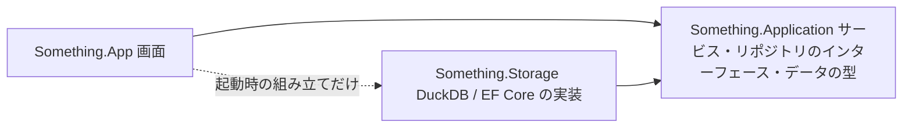
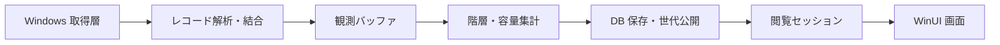

# アーキテクチャ

## プロジェクトの境界

| プロジェクト | 責務 |
| --- | --- |
| `Something.Ntfs` | バイト列の解析、属性とデータランの解読、レコード結合、取得インターフェースと再検証 |
| `Something.Windows` | ボリュームと Windows API への読み取り専用アクセス、ファイル識別、Shell 操作 |
| `Something.Statistics` | 階層検証、容量帰属、フォルダー集計、表示対象の判定 |
| `Something.Application` | スキャンの調停、メモリ予約、閲覧セッション、設定、ファイル操作ワークフロー。リポジトリのインターフェースと、層をまたぐデータの型 |
| `Something.Storage` | アプリ層のリポジトリの実装。DuckDB の保存・照会、共有状態、履歴公開、保持整理、DB ファイル管理 |
| `Something.App` | WinUI 3 の画面、入力、状態遷移、通知、アニメーション |

純粋な NTFS 解析は、Windows API にも UI にも依存しません。統計の方針はパーサーに持たせず、保存エンジン固有の処理は保存層に閉じ込めます。

## リポジトリ

アプリ層は、必要な DB 操作をリポジトリのインターフェース（`Something.Application.Repositories`）として定義し、保存層がそれを実装します。アプリ層は保存層を参照しません。画面はアプリ層のサービス（`HistoryService`・`DriveScanner`・`ScanSession`・`FolderHistoryService`・`HistorySearchService`）だけを使い、保存層の実装を選ぶのは [`Composition`](../src/Something.App/Composition.cs) だけです。

| インターフェース | 責務 |
| --- | --- |
| `IScanHistoryRepository` | 履歴の一覧・件数、閲覧で開く、削除と保持の整理 |
| `IScanPublisher` | 完了したスキャンを最新の世代として公開し、開いたスナップショットを返す（公開と同じロックの中でリースを取る） |
| `IScanSnapshot`・`IHistorySnapshot` | 開いた 1 世代の一覧・親・容量分析・属性・ファイル・概要。公開の後に行う時間の記録も受け持つ |
| `IFolderChangeRepository` | 2 つの世代の差、期間での比較 |
| `IHistorySearchRepository`・`IHistorySearchSession` | 条件での検索。セッションが検索した世代を保ち、1 項目の時系列を読む |
| `IHistoryDatabase` | DB ファイルのサイズ、最適化、保存先の移動、全体の削除 |
| `ITemporaryScanRepository` | 履歴に残さないスキャン（診断・履歴のないデモ）を一時ファイルの DB へ公開し、開いたスナップショットを返す。スナップショットを閉じるとファイルが消える |
| `IParquetTableWriter` | Parquet 形式でのエクスポート |

リポジトリのメソッドは同期で、呼び出し元のスレッドで DB を操作します。ワーカーへの受け渡しと、同じ閲覧の直列化はサービスが行います。1 つの保存先のリポジトリは `HistoryRepositories` にまとめ、保存先を移すと `HistoryService` が丸ごと差し替えます。DB の作業メモリは、サービスが `ScanMemoryBudget` から予約して `IMemoryAllowance` としてリポジトリに渡します。アプリ層は機械の空きの調停だけを行い、リポジトリは空きを見て自分のエンジンに必要な量を決め（初期の上限と、途中で増やすときの量）、その量を許可枠に計上します。DuckDB の上限の刻み・下限・増やし方・倍の計上は、保存層の `DuckMemoryPolicy` が持ちます。

層をまたぐデータの型は、用途ごとの名前空間に置きます。

| 名前空間 | 主な型 |
| --- | --- |
| `Something.Application.Scanning` | `BufferedScan`・`ScanDescriptor`・`StagedObservation`・`ScanWorkProgress` |
| `Something.Application.History` | `ScanHistoryEntry`・`ScanHistorySummary`・`HistoryRetention`・`HistoryDeletion`・`ScanTimingSnapshot`・`HistoryFailure` |
| `Something.Application.Browsing` | `FolderEntry`・`FolderEntryPage`・`RankedFolder`・`AnalysisFileName` |
| `Something.Application.Comparison` | `FolderChangeReport`・`ComparisonSelection`・`EntryChanges` |
| `Something.Application.Search` | `HistorySearchCriteria`・`HistorySearchResult`・`SearchItem` |
| `Something.Application.Memory` | `AvailableMemory`・`MemoryHeadroom`・`IMemoryAllowance` |

保存層の公開は `StorageRepositories` だけです（EF Core が生成するマイグレーションを除く）。アプリ層が保存層や DuckDB・EF Core・SQLite を参照しないことは、`ArchitectureTests` が確かめます。アプリ層のテストは、インターフェースの偽の実装でサービス（`DriveScanner`・`HistoryService`・`HistorySearch` など）を DB なしで試せます。保存層のテストは、`InternalsVisibleTo` で実装（`ScanHistoryArchive`・`ScanStore`）を直接使います。

## スキャンの流れ

`DriveScanner` がワーカースレッドで取得・集計・保存を実行します。開始時に観測した MFT の範囲を走査し、ファイルごとに完全に結合した結果か、取得できなかったという状態を `BufferedScan` に保持します。スキャン中に観測を 1 件ずつ履歴 DB へ書き込むことはしません。

バッファ完成後に階層と容量を集計し、保存トランザクションで新しい観測状態・一覧・集計・履歴メタデータ・最新ポインターを確定します。失敗した途中の結果は公開せず、以前に公開した世代をそのまま使います。処理時間の最終的な記録は、公開後に別のトランザクションで行います。

読み取り・集計・保存の時間は、それぞれ計測します。進捗のステップ番号は処理の順番を示すもので、全体に対する進み具合の割合ではありません。詳しくは[履歴ストレージ](storage.md)と[性能計測](benchmarks.md)を参照してください。

## 並行性と所有権

異なるドライブのスキャンは並行して実行できます。同じドライブを重ねてスキャンすることはなく、スキャン中はドライブカードのボタンがキャンセルに切り替わります。取得バッファと DB の作業予算は `ScanMemoryBudget` が調停します。共有 DB への公開・整理は、DB ごとのゲートで調停します。

`ScanSession` は、1 つの世代への参照、読み取り操作の直列化、表示用のキャッシュを持ちます。画面はドライブごとに最新のセッションを保持し、切り替えのたびに全件を作り直すことはしません。参照を解放するときに、閲覧リースとキャッシュも解放します。

NTFS パーサーは呼び出し元のバッファを変更せず、プールから借りたメモリを返却後も持ち続けることはしません。取得層のハンドル・ストリーム・DB 接続は、それぞれの所有者が破棄します。

## 書き込みの境界

ボリュームの取得と NTFS 解析は読み取り専用です。履歴 DB と設定は、アプリの保存先へ書き込みます。実際のファイルを変更するのは、利用者が確認した[ごみ箱への移動](file-actions.md)だけです。DB の削除とファイルの削除は別の操作です。

## 実装上の制限

対象はドライブ文字で識別できるローカル NTFS です。フォルダー単位の取得、ネットワーク共有、他のファイルシステム、USN による差分取得、VSS による時点保証、データ種別の自動分類は実装していません。表示するフォルダーの絞り込みは、保存済みのドライブ全体の観測結果に対して行います。
