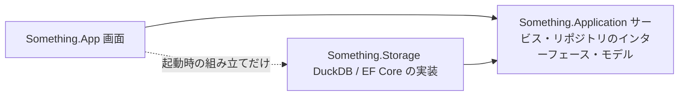

# リポジトリ構成への移行計画

保存層（`Something.Storage`）の DB 操作を、アプリ層（`Something.Application`）が定義するリポジトリのインターフェースの背後に移します。画面（`Something.App`）はアプリ層のサービスだけを使い、DB の種類・接続・セッションの解放順・メモリの予算を意識しなくて済むようにします。作業が進んだら、各段階の状態を更新します。

## 目標

- 画面は、アプリ層のサービスだけを呼ぶ。保存層の型は、起動時の組み立て（どの実装を使うかを決める箇所）でしか参照しない。
- アプリ層は、リポジトリのインターフェースとデータの型を定義する。DuckDB・EF Core・SQL を参照しない。
- 保存層は、アプリ層のインターフェースを実装する。DB 固有の設定（メモリの上限、スレッド数、一時表、ネイティブの読み取り）は保存層の中に閉じる。
- `Something.Ntfs`・`Something.Statistics`・`Something.Windows` の位置づけは変えない。

## 規約

| 項目 | 決め方 |
|---|---|
| 置き場所 | インターフェースはアプリ層の `Something.Application.Repositories`、データの型は用途ごとの名前空間（例：`Something.Application.History`） |
| 名前 | `I〇〇Repository`。開いたまま使う 1 世代は `IScanSnapshot`（`IDisposable`）。1 つの保存先のリポジトリ一式は `HistoryRepositories` にまとめ、保存先を移すと丸ごと差し替える |
| 同期・非同期 | リポジトリのメソッドは同期で、呼び出し元のスレッドで DB を操作する。DB ドライバーが同期のため、ワーカーへの受け渡しと、同じ閲覧の直列化はサービス（`HistoryService`・`ScanSession` など）が行う。画面に公開するサービスのメソッドは `Task` を返す |
| キャンセル | すべてのメソッドが `CancellationToken` を最後の引数で受け取る |
| 寿命 | 閲覧のスナップショットと検索の結果は、閉じるまで世代のリースを持つ。DB ファイルの操作（最適化・移動・全体の削除）は、開いているものを閉じてから行う |
| メモリ | DB の作業メモリは、アプリ層の `ScanMemoryBudget` から予約し、`IMemoryAllowance` として渡す。リポジトリが空きを見て量を決めて計上する。機械の空きの規則は [`MemoryHeadroom`](../../src/Something.Application/Memory/MemoryHeadroom.cs)、DuckDB の規則は保存層の `DuckMemoryPolicy` |
| 実装の公開範囲 | 保存層の実装クラスは `internal`。起動時の組み立て用に、インターフェースを返す入口だけを `public` にする |
| テスト | 保存層のテストは、これまでどおり実装を直接使う。アプリ層のテストは、インターフェースの偽の実装を使えるようにする |

DI コンテナーは導入せず、起動時に手で組み立てます。

## リポジトリとサービス

| リポジトリ | 責務 | 主な利用者 |
| --- | --- | --- |
| スキャン履歴（`IScanHistoryRepository`） | 一覧、保存（公開）、保持の整理、削除、件数、時間の記録、閲覧で開く | 履歴タブ、スキャン |
| スキャンの閲覧（`IScanSnapshot`・`IHistorySnapshot`） | 1 世代の一覧・親・容量分析・属性・ファイル・概要 | ファイル・容量分析タブ |
| 比較（`IFolderChangeRepository`） | 2 つの世代の差、期間での比較 | 比較 |
| 履歴の検索（`IHistorySearchRepository`） | 条件での検索、1 項目の時系列 | 検索タブ、グラフ |
| DB ファイルの管理（`IHistoryDatabase`） | サイズ、最適化、保存先の移動、全体の削除 | 履歴タブ、設定 |
| 一時的なスキャン用 DB（`ITemporaryScanRepository`） | 履歴に残さないスキャン（デモ・診断） | スキャン |

画面に対しては、次のサービスを公開します（名前は実装時に調整します）。

| サービス | 画面から使う操作 |
| --- | --- |
| スキャン | スキャン、デモ |
| 履歴 | 一覧、最新を開く、指定の世代を開く、削除、件数 |
| 比較 | 期間・任意の 2 世代の比較（表示設定の適用を含む） |
| 検索 | 範囲の確認、検索、時系列 |
| DB の管理 | サイズ、最適化、保存先の移動、全体の削除（開いているセッションの解放を含む） |

## 段階

各段階の終わりで、ソリューションのビルド、テスト、整形の確認が通る状態にしてコミットします。

### A. 画面からの直接の呼び出しをサービス経由にする

- [x] 画面が使う保存層の操作（`ScanHistoryArchive`・`ScanStore`・`ScanSession` の静的メソッド）を洗い出す
- [x] アプリ層に `HistoryService` を作る。履歴の一覧・件数・削除・閲覧セッション・最適化・保存先の移動・全体の削除を、呼び出し元のスレッドの外で行う。保存先を移すと中の履歴を差し替えるため、スキャン・比較・検索は作り直さない
- [x] 最適化のメモリの上限の計算を、画面からサービスへ移す（セッションの解放は、画面の状態を持つ `MainWindow` に残る。段階 B で見直す）
- [x] 画面の呼び出しをサービスに置き換える。画面に残る保存層の参照は、データの型と、DB を使わない計算（`ComparisonSelection`・`HistoryDeletion` の範囲の選択）だけ。これらは段階 C でアプリ層へ移す

### B. リポジトリのインターフェースを入れる

- [x] アプリ層にリポジトリのインターフェースを作る（データの型は、この段階ではまだ保存層のもの）。置き場所は `src/Something.Application/Repositories/`
- [x] 一時的に、アプリ層の中に保存層を呼ぶ実装を置く（`src/Something.Application/StorageAdapters/`、`internal`）
- [x] サービス（`DriveScanner`・`ScanSession`・`FolderHistoryService`・`HistorySearchService` を含む）がインターフェースだけを使うようにする。`HistoryService` はリポジトリ一式を受け取るコンストラクターを公開し、偽の実装でサービスを試すテストを加えた

### C. 参照の向きを逆にする

- [x] 層をまたぐデータの型（`ScanHistoryEntry`、`FolderEntry`、`FolderChangeReport`、検索の条件・結果、`BufferedScan` など）をアプリ層へ移す。名前空間は `Scanning`・`History`・`Browsing`・`Comparison`・`Search`・`Memory`。観測の検証は `ScanDescriptor.Validate`・`StagedObservation.Validate` にし、保存層からも呼ぶ。検索結果の世代番号は保存層の派生クラス（`StoredSearchResult`）に閉じる
- [x] B の実装を保存層へ移し、`internal` にする（`src/Something.Storage/Repositories/`）。起動時の組み立て用の入口は `StorageRepositories` だけを `public` にする。DuckDB を直接使っていた Parquet の書き出しも `IParquetTableWriter` の実装にする
- [x] プロジェクトの参照を「保存層 → アプリ層」に切り替え、アプリ層から保存層への参照を外す
- [x] 画面は起動時の組み立て（[`Composition`](../../src/Something.App/Composition.cs)）だけで保存層を参照する
- [x] ツール（`tools/`）とテストの参照を合わせる（テストは `TestHistory.For` で保存層の実装からサービスを作る）
- [x] [アーキテクチャ](../architecture.md)の文書を更新する

### E. 設計の洗練（D の前に行う）

段階 C の後の見直しで残った問題を、大きな変更になっても直します。各項目の終わりで、ビルド・テスト・整形の確認を通してコミットします。動きは変えず、変えるときはこの計画に書きます。

| 問題 | 方針 |
| --- | --- |
| 検索の条件判定（名前・拡張子・属性・サイズ・増減・振れ幅・傾向・深さ・基準フォルダー）が保存層のエンジンの中にある | アプリ層の `SearchConditions` に移し、DB なしで試せるようにする。保存層に残すのは、SQL での粗い絞り込み、行の畳み込み、ツリーの配置だけ |
| `SearchTree` を変更可能なまま公開し、`HistorySearchResult` を継承可能にしている。時系列の読み取りが実行時の型変換に頼る | 検索結果を不変のデータ（`sealed`、項目から組み立てる）にする。リースと世代番号は、保存層の検索セッション（`IHistorySearchSession`）が持ち、時系列はセッションから読む |
| NTFS の属性ビットが検索の定数と統計層の数値リテラルに散らばる | 値が同じ .NET 標準の `System.IO.FileAttributes` を使う（NTFS の標準属性と Windows の FILE_ATTRIBUTE_* は同じ値） |
| DB 固有のメモリ設定（DuckDB の上限の刻み・下限・初期値・増やし方、上限の 2 倍の計上、メモリ DB とファイル DB の選択、DB サイズの見積もり）がアプリ層にある | アプリ層は機械の空きと予約の調停だけを持ち、`IMemoryAllowance` で「空きを見て決めた量を、他の予約と競合せずに計上する」操作を渡す。DuckDB の規則は保存層へ移す。使われていない `ScanSession.Selection` は削除する |
| 集計前の `BufferedScan` を公開に渡せてしまい、未完了は実行時の例外で防いでいる | `Complete` が不変の `CompletedScan` を返し、公開はそれだけを受け取る |
| 履歴への保存（`Save`）が保存層自身のスナップショットしか受け付けない。一時 DB の `Open` が所有を引き継ぐ約束をコメントだけで表す | `Save` はデモの履歴でしか使わないため、デモも履歴があればそこへ直接公開し、`Save` をなくす。公開は開いたスナップショットを返す（リースを公開と同じロックの中で取る）。一時 DB は公開と同時にスナップショットとして返し、所有の受け渡しをなくす |
| インターフェースが大きく、1 つの実装クラスが 4 つのインターフェースを兼ねる | 履歴の一覧・管理（`IScanHistoryRepository`）と公開（`IScanPublisher`）を分け、実装も役割ごとのクラスにする |
| 保存層の実装クラス（`ScanHistoryArchive`・`ScanStore` など）が公開のまま | `StorageRepositories` 以外を `internal` にする。直接使うテストとツール（`Something.LiveInspect`・`Something.StorageCompare`）には `InternalsVisibleTo` を使う |
| 機械的に足した using が残りうる | 使われていない using（IDE0005）をビルドで検出して取り除き、今後も検出し続ける |

`SearchItem.FollowsIdentity` は、[検索の仕様](../search.md)のハードリンクの規則（名前が 1 つなら名前の変更・移動に追従する）を表す項目のため、隠さずに意味のある公開の項目として残します。

テスト：各項目で、DB なしで試せるようになった部分（検索の条件判定、検索結果の組み立て、メモリの調停、スキャンの完了、サービスの流れ）のテストを加えます。保存層の実装は、これまでどおり実際の DB でテストします。境界の値・不正な入力・キャンセルを含めます。

作業の順番：

- [x] E1. 使われていない using をビルドで検出し、取り除く（IDE0005 の検出には XML コメントの生成が要るため、コメントの不備も検出するようになった。公開の型へのコメントの有無（CS1591）は問わない）
- [x] E2. 属性ビットの数値を `System.IO.FileAttributes` に置き換える
- [x] E3. 検索の条件判定を `SearchConditions` としてアプリ層へ移し、DB なしのテストを加える（`SearchConditionsTests`。正規表現の生成と標準属性の有無の判定は `internal` に戻した）
- [x] E4. 検索結果を不変のデータにし、リース・世代番号・時系列の読み取りを検索セッションへ移す（結果は組み立て時に木の形を検証する。画面には `HistorySearch` が結果・時系列・解放を提供する。テストは `HistorySearchResultTests`）
- [x] E5. `Complete` が `CompletedScan` を返し、公開はそれだけを受け取る（集計結果・診断・帰属の診断・DB サイズの見積もりは `CompletedScan` だけが持つ。見積もりは E6 で保存層へ移す。テストは `CompletedScanTests`）
- [x] E6. メモリの調停を `IMemoryAllowance` にし、DuckDB 固有の規則・DB の選択・サイズの見積もりを保存層へ移す（アプリは常にファイル DB を使うため、メモリ DB とファイル DB の選択はアプリ層から外した。選択とサイズの見積もりは、診断ツールと旧 SQLite の比較のために保存層に残す。最適化は他と競合しないため `UnsharedMemoryAllowance` を使う。使われていなかった `ScanSession.Selection` は削除。テストは `ScanMemoryBudgetTests`（調停）と `DuckMemoryPolicyTests`（DuckDB の規則））
- [x] E7. 公開の形を整える。(1) `Save`（スナップショットの型変換に頼る）と `ScanSession.SaveHistoryAsync` を、デモを通常のスキャンと同じく履歴へ直接公開することでなくす。(2) 履歴への公開と一時 DB への公開は、開いたスナップショットを返す（履歴では公開と同じロックの中でリースを取る）。時間の記録は `IScanSnapshot.SaveTimings` にする。(3) `IScanPublisher` を `IScanHistoryRepository` から分け、実装も役割ごとのクラスにする。(4) 保存層の `Save`・`CopyHistoryGeneration` は、旧 SQLite との比較のテストだけが使うため `internal` にする。デモが履歴へ公開されるようになったので、デモのスキャンでも進捗の段階は通常のスキャンと同じになる。テストは `DriveScannerTests`（履歴・一時 DB の選択、時間の記録、失敗時の解放、キャンセル。DB なし）
- [ ] E8. 保存層の公開範囲を `StorageRepositories` だけにする
- [ ] E9. [アーキテクチャ](../architecture.md)・[履歴ストレージ](../storage.md)・この計画の規約を更新する

検証：各項目でテストがすべて通ること。E の終わりに、`--app-paths` の照会のチェックサムが段階 C の前と一致することと、画面のスモークテストを、確認を取ってから実行します。

### D. 検索の高速化（移行後）

- [ ] 名前が変わる識別子の読み取りを、名前ごとの整数の集計にする
- [ ] 検索セッションで、同じ範囲・同じサイズの種類の集計を使い回す。保持するメモリは予算に計上する

## 検証

- 各段階で、ソリューションのテストがすべて通ること。保存層のテストは変更前と同じ結果になること。
- 段階 C の前後で、`--app-paths` の照会のチェックサムが一致すること（ベンチマークは実行前に確認を取る）。
- 画面のスモークテストは、アプリがフォーカスを奪うため、実行前に確認を取る。

## 範囲外

- 表示設定・DB 設定の JSON の保存（`DisplaySettingsStore`・`DatabaseSettingsStore`）は DB ではないため、今回は移さない。
- SQLite の比較用の実装と診断用の経路は、保存層の内部のまま残す。
