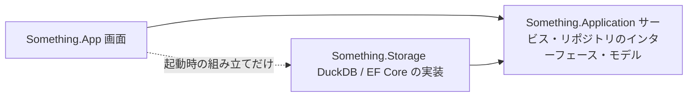

# リポジトリ構成への移行計画

保存層（`Something.Storage`）の DB 操作を、アプリ層（`Something.Application`）が定義するリポジトリのインターフェースの背後に移します。画面（`Something.App`）はアプリ層のサービスだけを使い、DB の種類・接続・セッションの解放順・メモリの予算を意識しなくて済むようにします。作業が進んだら、各段階の状態を更新します。

## 目標

- 画面は、アプリ層のサービスだけを呼ぶ。保存層の型は、起動時の組み立て（どの実装を使うかを決める箇所）でしか参照しない。
- アプリ層は、リポジトリのインターフェースとデータの型を定義する。DuckDB・EF Core・SQL を参照しない。
- 保存層は、アプリ層のインターフェースを実装する。DB 固有の設定（メモリの上限、スレッド数、一時表、ネイティブの読み取り）は保存層の中に閉じる。
- `Something.Ntfs`・`Something.Statistics`・`Something.Windows` の位置づけは変えない。

## 規約

| 項目 | 決め方 |
|---|---|
| 置き場所 | インターフェースはアプリ層の `Something.Application.Repositories`、データの型は用途ごとの名前空間（例：`Something.Application.History`） |
| 名前 | `I〇〇Repository`。開いたまま使うものはセッション（`I〇〇Session`、`IAsyncDisposable`） |
| 非同期 | リポジトリのメソッドは `Task` を返し、呼び出し元のスレッドで DB を操作しない。DB ドライバーは同期なので、実装の中でワーカーに渡す |
| キャンセル | すべてのメソッドが `CancellationToken` を最後の引数で受け取る |
| 寿命 | 閲覧・検索のセッションは、閉じるまで世代のリースを持つ。DB ファイルの操作（最適化・移動・全体の削除）は、サービスが開いているセッションを閉じてから行う |
| メモリ | DB の作業メモリは、アプリ層の `ScanMemoryBudget` から予約し、その値をリポジトリに渡す。規則は [`MemoryHeadroom`](../../src/Something.Storage/MemoryHeadroom.cs) |
| 実装の公開範囲 | 保存層の実装クラスは `internal`。起動時の組み立て用に、インターフェースを返す入口だけを `public` にする |
| テスト | 保存層のテストは、これまでどおり実装を直接使う。アプリ層のテストは、インターフェースの偽の実装を使えるようにする |

DI コンテナーは導入せず、起動時に手で組み立てます。

## リポジトリとサービス

| リポジトリ | 責務 | 主な利用者 |
| --- | --- | --- |
| スキャン履歴 | 一覧、保存（公開）、保持の整理、削除、件数、時間の記録 | 履歴タブ、スキャン |
| スキャンの閲覧（セッション） | 1 世代の一覧・親・容量分析・属性・ファイル・概要 | ファイル・容量分析タブ |
| 比較 | 2 つの世代の差、期間での比較 | 比較 |
| 履歴の検索（セッション） | 範囲の集計、条件での検索、1 項目の時系列 | 検索タブ、グラフ |
| DB ファイルの管理 | サイズ、最適化、保存先の移動、全体の削除 | 履歴タブ、設定 |
| 一時的なスキャン用 DB | 履歴に残さないスキャン（デモ・診断） | スキャン |

画面に対しては、次のサービスを公開します（名前は実装時に調整します）。

| サービス | 画面から使う操作 |
| --- | --- |
| スキャン | スキャン、デモ |
| 履歴 | 一覧、最新を開く、指定の世代を開く、削除、件数 |
| 比較 | 期間・任意の 2 世代の比較（表示設定の適用を含む） |
| 検索 | 範囲の確認、検索、時系列 |
| DB の管理 | サイズ、最適化、保存先の移動、全体の削除（開いているセッションの解放を含む） |

## 段階

各段階の終わりで、ソリューションのビルド、テスト、整形の確認が通る状態にしてコミットします。

### A. 画面からの直接の呼び出しをサービス経由にする

- [x] 画面が使う保存層の操作（`ScanHistoryArchive`・`ScanStore`・`ScanSession` の静的メソッド）を洗い出す
- [x] アプリ層に `HistoryService` を作る。履歴の一覧・件数・削除・閲覧セッション・最適化・保存先の移動・全体の削除を、呼び出し元のスレッドの外で行う。保存先を移すと中の履歴を差し替えるため、スキャン・比較・検索は作り直さない
- [x] 最適化のメモリの上限の計算を、画面からサービスへ移す（セッションの解放は、画面の状態を持つ `MainWindow` に残る。段階 B で見直す）
- [x] 画面の呼び出しをサービスに置き換える。画面に残る保存層の参照は、データの型と、DB を使わない計算（`ComparisonSelection`・`HistoryDeletion` の範囲の選択）だけ。これらは段階 C でアプリ層へ移す

### B. リポジトリのインターフェースを入れる

- [ ] アプリ層にリポジトリのインターフェースを作る（データの型は、この段階ではまだ保存層のもの）
- [ ] 一時的に、アプリ層の中に保存層を呼ぶ実装を置く
- [ ] サービス（`DriveScanner`・`ScanSession`・`FolderHistoryService`・`HistorySearchService` を含む）がインターフェースだけを使うようにする

### C. 参照の向きを逆にする

- [ ] 層をまたぐデータの型（`ScanHistoryEntry`、`FolderEntry`、`FolderChangeReport`、検索の条件・結果、`BufferedScan` など）をアプリ層へ移す
- [ ] B の実装を保存層へ移し、`internal` にする
- [ ] プロジェクトの参照を「保存層 → アプリ層」に切り替え、アプリ層から保存層への参照を外す
- [ ] 画面は起動時の組み立てだけで保存層を参照する
- [ ] ツール（`tools/`）とテストの参照を合わせる
- [ ] [アーキテクチャ](../architecture.md)の文書を更新する

### D. 検索の高速化（移行後）

- [ ] 名前が変わる識別子の読み取りを、名前ごとの整数の集計にする
- [ ] 検索セッションで、同じ範囲・同じサイズの種類の集計を使い回す。保持するメモリは予算に計上する

## 検証

- 各段階で、ソリューションのテストがすべて通ること。保存層のテストは変更前と同じ結果になること。
- 段階 C の前後で、`--app-paths` の照会のチェックサムが一致すること（ベンチマークは実行前に確認を取る）。
- 画面のスモークテストは、アプリがフォーカスを奪うため、実行前に確認を取る。

## 範囲外

- 表示設定・DB 設定の JSON の保存（`DisplaySettingsStore`・`DatabaseSettingsStore`）は DB ではないため、今回は移さない。
- SQLite の比較用の実装と診断用の経路は、保存層の内部のまま残す。
